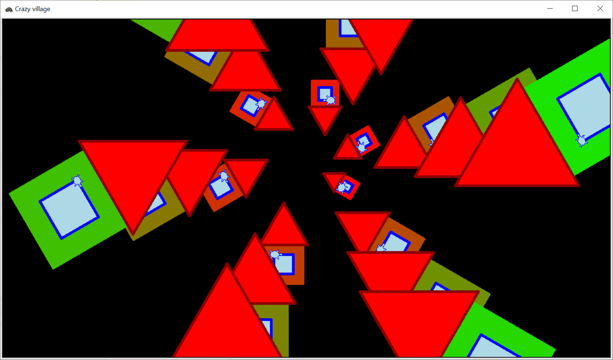
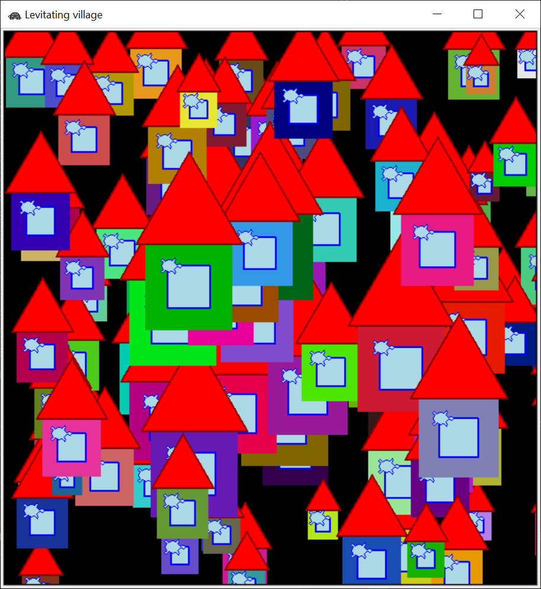
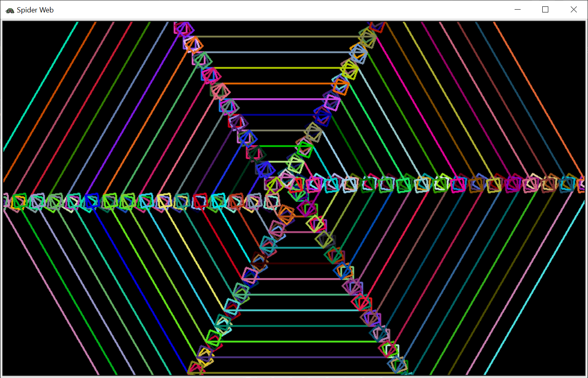
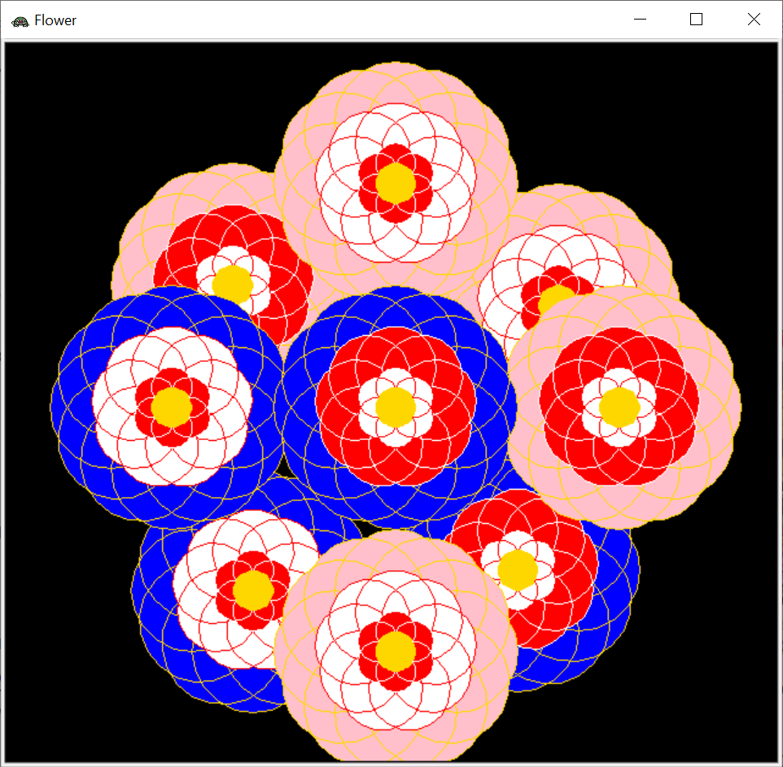
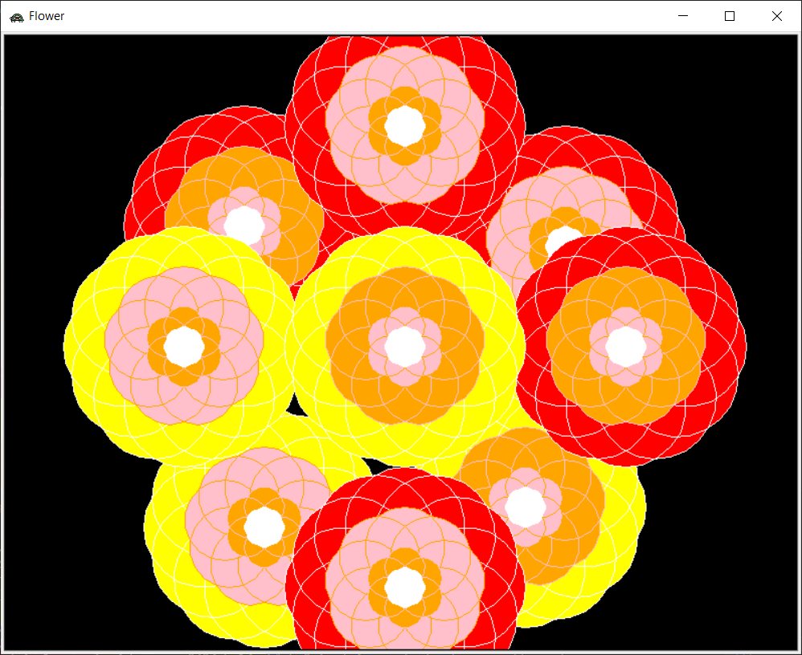
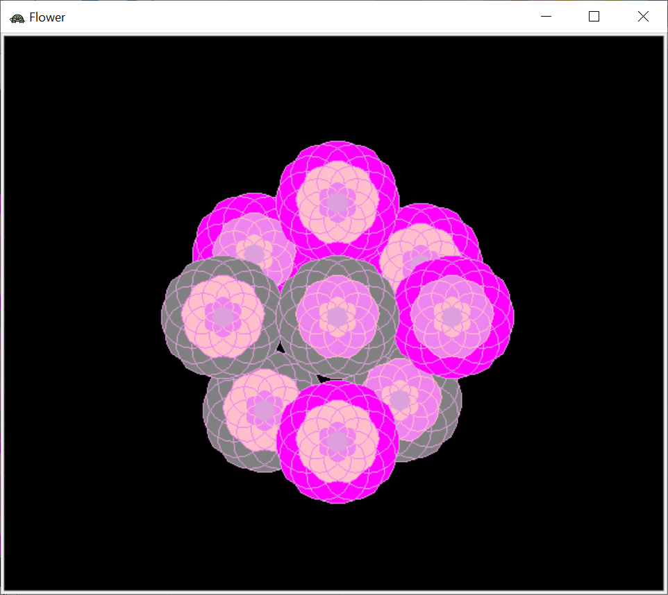
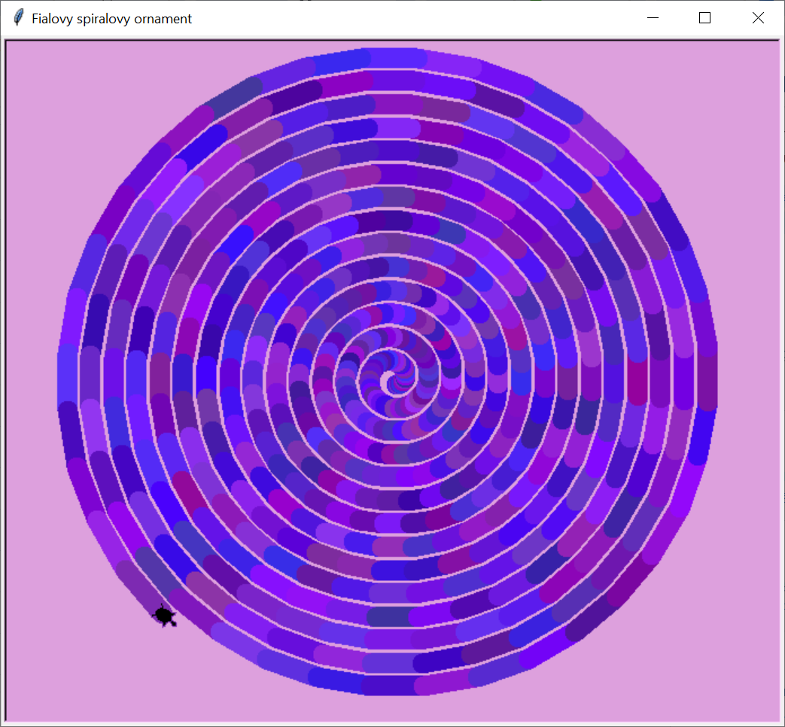
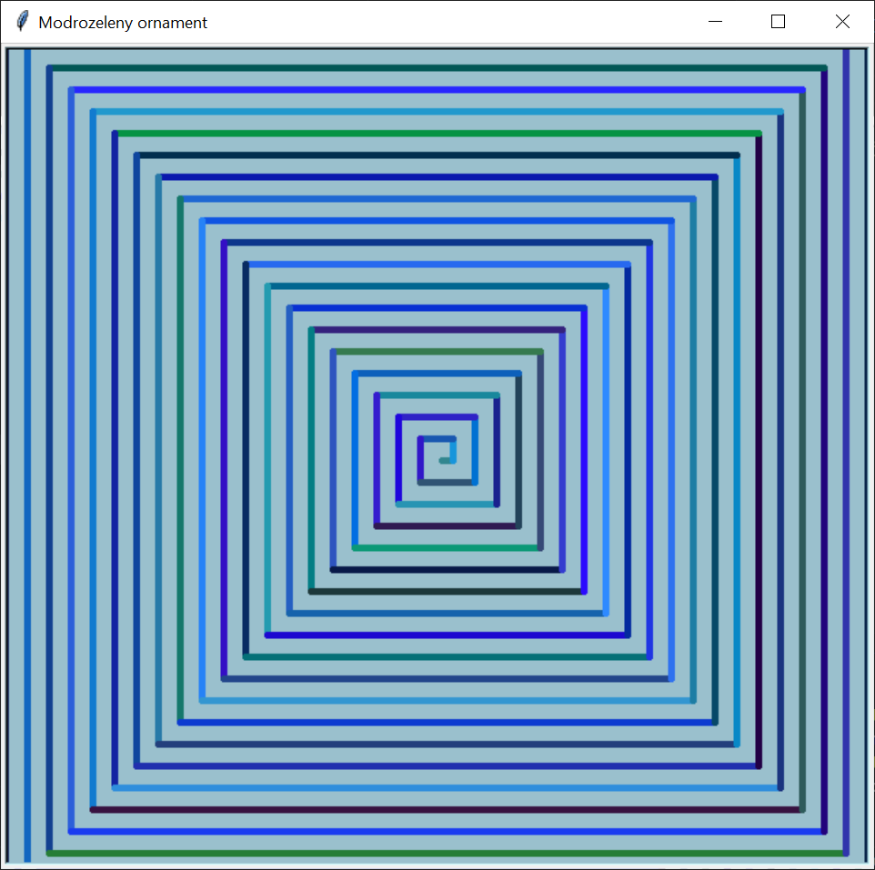

# PythonBasicsTurtle

  
  
  
  
  
   

  
  
  
  
  
   

  

Dive into a collection of Python Turtle codes that bring your imagination to life on screen. From quaint villages and colorful spider webs to mesmerizing spiral ornaments and enchanting flowers.

# Table of Contents (ToC)

1. [PythonBasicsTurtle](#pythonbasicsturtle)
2. [crazyvilllage.py](#crazyvilllagepy)
    - [Application Window](#application-window)
    - [How It Works](#how-it-works)
3. [vesnice.py](#vesnicepy)
    - [Application Window](#application-window-1)
    - [How It Works](#how-it-works-1)
4. [pavucina.py](#pavucinapy)
    - [Application Window](#application-window-2)
    - [How It Works](#how-it-works-2)
5. [kytice.py](#kyticepy)
    - [Application Window](#application-window-3)
    - [How It Works](#how-it-works-3)
    - [examples](#examples)
6. [fialovyornament.py](#fialovyornamentpy)
7. [modrozelenyornament.py](#modrozelenyornamentpy)

---

- **Villages:** Build your own picturesque village with colorful houses.
- **Spider Webs:** Weave intricate and colorful webs with randomly generated patterns.
- **Spirals:** Draw mesmerizing spiral ornaments with vibrant shades of purple.
- **Flowers:** Design a bouquet of captivating flowers with customizable colors and petal shapes.

---

## crazyvilllage.py
It provides instructions on how to use the Crazy Village application, which draws a village using the Turtle graphics library.
### Application Window
The application window displays a village with houses of different sizes and colors. The background of the window is black, and the title of the window is "Crazy Village".
### How It Works
The application uses the Turtle graphics library to draw the village. The code defines a function called domecek that draws a house. The function takes three arguments:
- **t:** The Turtle object that will be used to draw the house.
- **velikostDomecku:** The size of the house.
- **barva:** The color of the house.
The code then creates a new Turtle object and sets its properties, such as shape, speed, and pen size. The code then uses a for loop to draw 20 houses. For each house, the code generates special color and size, and then calls the domecek function to draw the house. The application draws a village with 20 houses of different sizes and colors. Houses are arranged in a spiral shape

---

## vesnice.py
It provides instructions on how to use the Levitating Village application, which draws a levitating village using the Turtle graphics library.
### Application Window
The application window displays a village with houses of different sizes and colors levitating in a black space. The title of the window is "Levitating Village".
### How It Works
The application uses the Turtle graphics library to draw the village. The code defines a function called domecek that draws a house. The function takes three arguments:
- **t:** The Turtle object that will be used to draw the house.
- **velikost:** The size of the house.
- **barva:** The color of the house.
The code then creates a new Turtle object and sets its properties, such as shape, speed, and pen size. The code then uses a for loop to draw 100 houses. For each house, the code generates a random position, color, and size, and then calls the domecek function to draw the house.

---

## pavucina.py
It provides instructions on how to use the Colorful Spider Web application, which draws a colorful spider web using the Turtle graphics library.
### Application Window
The application window displays a colorful spider web with intricate patterns. The background of the window is black, and the title of the window is "Spider Web".
### How It Works
The application uses the Turtle graphics library to draw the spider web. The code uses a for loop to draw 100 nodes, each of which consists of 3 loops. Each loop draws 4 edges, and the color of each edge is randomly generated. The distance between nodes increases as the web expands, creating a spiral pattern. The background of the window is black.

---

## kytice.py
It provides instructions on how to use the Flower application, which draws a flower using the Turtle graphics library.
### Application Window
The application window displays a flower with colorful petals. The background of the window is black, and the title of the window is "Flower".
### How It Works
The application uses the Turtle graphics library to draw the flower. The code defines two functions:
- **okvetniListky(t, s, count, col1, col2):** This function draws a layer of petals. It takes five arguments:
  - **t:** The Turtle object that will be used to draw the petals.
  - **s:** The size of the petals.
  - **count:** The number of petals in the layer.
  - **col1:** The fill color of the petals.
  - **col2:** The outline color of the petals.
- **kvetina(t, s, col1, col2, col3, col4):** This function draws a flower. It takes six arguments:
  - **t:** The Turtle object that will be used to draw the flower.
  - **s:** The size of the flower.
  - **col1:** The color of the outer petals.
  - **col2:** The alternate color of the outer petals.
  - **col3:** The color of the middle petals.
  - **col4:** The color of the center of the flower.
The code then creates a new Turtle object and sets its properties, such as speed and pen size. The code then calls the kvetina function to draw the flower.

#### examples

---

## fialovyornament.py

---

## modrozelenyornament.py

---

## Author
Lovingly crafted by [Hanka Robovska](https://github.com/hrosicka) 👩‍🔬

---

## License
This project is licensed under the MIT License. See the [LICENSE](./LICENSE) file for details. Free to use, modify, and distribute as needed.
